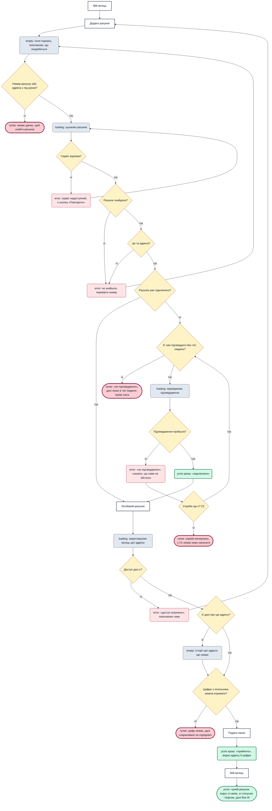

# User flows

Екрани — з реєстру [sitemap.md](sitemap.md), статуси — з його розділу «Сутності», jobs — з [jtbd.md](jtbd.md).
Персони й обставини — з [personas.md](personas.md). Коди джерел (`[t1]`) — з [research/research.md](research/research.md).

Нових екранів flows не потребували.

## Як читати

| Вузол | Форма | Що це |
|-------|-------|-------|
| Екран | `[Назва]`, прямокутник | Назва дослівно з реєстру екранів. Той самий екран може стояти кілька разів, якщо людина туди повертається |
| Розвилка | `{питання?}`, ромб | Дані можуть не прийти, введення може бути хибним або дія може не пройти |
| Стан | `("...")`, заокруглений | Стан екрана, що стоїть перед ним. Підпис починається з типу: `empty`, `error`, `loading`, `стан`, `успіх кроку` |
| Перехід | `("перехід: ...")`, заокруглений | Далі читати інший flow |
| Кінець | `(["..."])`, овал | `успіх` або `тупик`: людина застрягла і продукт зараз не дає їй виходу |

Тип кінця й стану написано словом, тож колір лише допомагає. `[?]` означає те саме, що в [sitemap.md](sitemap.md): це припущення.

## Чому ці jobs

**Main job M** — обов'язковий. До нього обрано три related jobs:

| Job | Чому | Сигнал |
|-----|------|--------|
| **R6** Знати, звідки взялися цифри | **Найризикованіший для довіри.** Людина платить за те, чого не споживала, і не може це змінити. Належить до ядра MVP разом із M | 32 відгуки в доресерчі; важливість 3; конкуренти не виконують |
| **R2** Виправити помилку без мороки | **Найчастіша помилка на шляху M.** Зайву цифру людина робить сама. Теж у ядрі MVP | Важливість 3, [y6][n4][n6]; конкуренти не виконують |
| **R7** Вести чужий рахунок | **Найризикованіший для Андрія.** Якщо він не дістався до рахунку, місяць не почнеться взагалі | Важливість 3 для secondary, [e1][e2][t1] |

Частота тут лише орієнтовна: лічильники відгуків — нижня межа без знаменника ([research.md](research/research.md), «Межі»).

**Чому немає окремого flow для R5 і R1.** Вони вже всередині M: відмова, збій сервісу, стрибок і нечітке фото є його розвилками. **R3** теж там: звірка суми на «Сума й оплата». **R4** і **R8** важливі, але помилка в них не блокує місяць: R4 уже закрито правилами перемикача, а R8 — це перегляд без дій.

---

## M. Закрити місяць без сумніву

[Main job](jtbd.md#main-job). **Персона:** Наталя (`checker`, primary). **Обставини:** сценарій `at-meter`: телефон, вікно подачі, показ — дрібна справа між іншими; наступного дня перевіряє, чи показ на місці. Сесія активна. Flow охоплює два заходи: подачу й оплату.

```mermaid
flowchart TD
    home[Мій місяць] --> loadHome("loading: завантажуємо місяць")
    loadHome --> dData{"Дані місяця прийшли?"}
    dData -->|ні| errHome("error: не вдалося завантажити, є кнопка «Повторити»")
    errHome --> dRetry{"Повтор вдався?"}
    dRetry -->|ні| deadService(["тупик: сервіс недоступний, лишається прийти пізніше"])
    dRetry -->|так| dAccount
    dData -->|так| dAccount{"Особовий рахунок уже є?"}
    dAccount -->|ні| emptyHome("empty: рахунків ще немає")
    emptyHome --> add[Додати рахунок]
    add --> dAdded{"Рахунок підключено?"}
    dAdded -->|ні| linkR7("перехід: flow R7")
    dAdded -->|так| dDone
    dAccount -->|так| dDone{"Показ цього місяця вже прийнято?"}
    dDone -->|так| wait
    dDone -->|ні| dWindow{"Вікно подачі відкрите?"}
    dWindow -->|ні| dMissed{"Вікно вже минуло?"}
    dMissed -->|ні| deadEarly(["тупик: подати ще не можна, показуємо дату відкриття"])
    dMissed -->|так| avg("стан: «нараховано за середнім», показу не було")
    avg --> loadBill

    dWindow -->|так| reading[Подати показ]
    reading --> dPrev{"Попередній показ є?"}
    dPrev -->|ні| emptyPrev("empty: попереднього показу ще немає, звірити ні з чим")
    dPrev -->|так| fields("стан: порожні поля, поруч попередній показ")
    emptyPrev --> dMethod
    fields --> dMethod{"Подає за фото? [?]"}
    dMethod -->|так| loadPhoto("loading: розпізнаємо цифри")
    loadPhoto --> dPhoto{"Цифри розпізнано чітко?"}
    dPhoto -->|ні| errPhoto("error: нечітке фото, переходимо до ручних полів")
    errPhoto --> manual
    dPhoto -->|так| photoOk("стан: цифри з фото в полях, поруч фото, можна поправити")
    photoOk --> dLow
    dMethod -->|ні| manual("стан: вводить цифри вручну")
    manual --> dLow{"Цифри не менші за попередній показ?"}
    dLow -->|ні| errLow("error: менше за попередній показ")
    errLow --> dOwn{"Помилилася у своїх цифрах?"}
    dOwn -->|так| manual
    dOwn -->|ні| deadLow(["тупик: попередній показ хибний, свої цифри форма не приймає, далі flow R6"])
    dLow -->|так| dJump{"Стрибок понад 3× від середнього?"}
    dJump -->|так| warn("стан: схоже на зайву цифру, перевірте")
    warn --> dSure{"Цифри правильні?"}
    dSure -->|ні| manual
    dSure -->|так| send
    dJump -->|ні| send("loading: надсилаємо показ")
    send --> dServer{"Сервіс відповів?"}
    dServer -->|ні| draft("error: сервіс недоступний, чернетка «ще не надіслано» [?]")
    draft --> dBack{"Сервіс ожив до кінця вікна?"}
    dBack -->|так| send
    dBack -->|ні| avg
    dServer -->|так| dAccepted{"Показ прийнято?"}
    dAccepted -->|ні| rejected("error: «відхилено», причина людською мовою")
    rejected --> manual
    dAccepted -->|так| accepted("успіх кроку: «прийнято», цифри, час, орієнтовна сума")

    accepted --> dMistake{"Помітила помилку в цифрах?"}
    dMistake -->|так| linkR2("перехід: flow R2")
    dMistake -->|ні| history[Історія]
    history --> dKept{"Наступного дня показ на місці?"}
    dKept -->|ні| errGone("error: показу немає, пояснюємо причину")
    errGone --> reading
    dKept -->|так| wait("loading: чекаємо нарахування, показуємо дату")
    wait --> dCalc{"Нарахування прийшло в обіцяну дату?"}
    dCalc -->|ні| errLate("error: затримка, показуємо нову дату")
    errLate --> wait
    dCalc -->|так| homeBill[Мій місяць]
    homeBill --> dBalance{"Є сума до сплати?"}
    dBalance -->|ні| okNoPay(["успіх: місяць закрито без оплати, «без боргу» або «переплата»"])
    dBalance -->|так| bill[Сума й оплата]
    bill --> loadBill("loading: завантажуємо розшифровку")
    loadBill --> dBreak{"Розшифровка прийшла?"}
    dBreak -->|ні| errBill("error: не вдалося завантажити суму, є кнопка «Повторити»")
    errBill --> loadBill
    dBreak -->|так| dBasis{"Пораховано за моїм показом?"}
    dBasis -->|ні| linkR6("перехід: flow R6")
    dBasis -->|так| dAgree{"Сума збігається з моїм розрахунком?"}
    dAgree -->|ні| deadDisagree(["тупик: не згодна з сумою, у V1 немає кому написати"])
    dAgree -->|так| pay("loading: проводимо платіж")
    pay --> dBank{"Банк відповів одразу?"}
    dBank -->|ні| processing("loading: «в обробці» [?]")
    processing --> dPaid
    dBank -->|так| dPaid{"Платіж пройшов?"}
    dPaid -->|ні| errPay("error: «не пройшов» [?], гроші не списано")
    errPay --> dRetryPay{"Спробує ще раз?"}
    dRetryPay -->|так| pay
    dRetryPay -->|ні| deadPay(["тупик: борг лишається, далі «прострочено»"])
    dPaid -->|так| paid("успіх кроку: «сплачено», квитанція")
    paid --> homeDone[Мій місяць]
    homeDone --> okClosed(["успіх: місяць закрито, цифри зараховано, сума звірена, нічого не винна"])

    classDef screen fill:#ffffff,stroke:#334155,stroke-width:2px,color:#0f172a
    classDef decision fill:#fef3c7,stroke:#92400e,color:#0f172a
    classDef state fill:#e2e8f0,stroke:#475569,color:#0f172a
    classDef bad fill:#ffe4e6,stroke:#9f1239,color:#0f172a
    classDef good fill:#d1fae5,stroke:#065f46,stroke-width:2px,color:#0f172a
    classDef dead fill:#fecdd3,stroke:#881337,stroke-width:3px,color:#0f172a
    class home,add,reading,history,homeBill,bill,homeDone screen
    class dData,dRetry,dAccount,dAdded,dDone,dWindow,dMissed,dPrev,dMethod,dPhoto,dLow,dOwn,dJump,dSure,dServer,dBack,dAccepted,dMistake,dKept,dCalc,dBalance,dBreak,dBasis,dAgree,dBank,dPaid,dRetryPay decision
    class loadHome,emptyHome,avg,emptyPrev,fields,loadPhoto,photoOk,manual,warn,send,wait,loadBill,pay,processing,linkR2,linkR6,linkR7 state
    class errHome,errPhoto,errLow,draft,rejected,errGone,errLate,errBill,errPay bad
    class accepted,paid,okNoPay,okClosed good
    class deadService,deadEarly,deadLow,deadDisagree,deadPay dead
```

**Розвилки**
1. **Дані місяця прийшли?** Збій зовнішнього сервісу; повтор або тупик.
2. **Особовий рахунок уже є?** Перший захід веде на «Додати рахунок».
3. **Показ цього місяця вже прийнято?** Якщо так, людина вже на другому заході, одразу до нарахування.
4. **Вікно подачі відкрите? Вікно вже минуло?** Рано — тупик із датою. Пізно — «нараховано за середнім».
5. **Попередній показ є?** Для нового рахунку звірити нема з чим.
6. **Подає за фото?** `[?]` (H4). **Цифри розпізнано чітко?** Якщо ні, ручні поля.
7. **Цифри не менші за попередній? Помилилася у своїх?** Правило брифу. Якщо помилка не її, це тупик.
8. **Стрибок понад 3×? Цифри правильні?** Попередження, не блокування.
9. **Сервіс відповів? Сервіс ожив до кінця вікна?** Збій саме у вікно подачі [y6].
10. **Показ прийнято?** Відмова завжди з причиною [t1].
11. **Помітила помилку?** Веде у flow R2.
12. **Наступного дня показ на місці?** Її звичка перевіряти [t1].
13. **Нарахування прийшло в обіцяну дату?** Затримка не лишає людину без дати.
14. **Є сума до сплати?** Без боргу чи з переплатою місяць закривається без платежу (питання 4 у sitemap).
15. **Розшифровка прийшла? Пораховано за моїм показом? Сума збігається?** Три сумніви R3 і R6 перед оплатою.
16. **Банк відповів одразу? Платіж пройшов? Спробує ще раз?** Збій зовнішнього сервісу.

**Стани**
- **empty:** рахунків ще немає · попереднього показу ще немає.
- **error:** не завантажено місяць · нечітке фото · менше за попередній показ · сервіс недоступний, чернетка `[?]` · «відхилено» з причиною · показу немає наступного дня · затримка нарахування · не завантажено суму · «не пройшов» `[?]`.
- **loading:** завантаження місяця · розпізнавання цифр · надсилання показу · очікування нарахування · завантаження розшифровки · проведення платежу · «в обробці» `[?]`.
- **Інші:** порожні поля · цифри з фото · ручне введення · попередження про стрибок · «нараховано за середнім» · успіхи кроків «прийнято» і «сплачено».

**Кінці**
- **Успіх:** місяць закрито після оплати · місяць закрито без оплати.
- **Тупики:**
  - сервіс недоступний: лишається прийти пізніше;
  - вікно ще не відкрите: подати не можна (питання 3 у sitemap);
  - попередній показ хибний: свої цифри форма не приймає (питання до PM у jtbd.md);
  - не згодна із сумою: чату з підтримкою немає у V1 (бриф, р. 8);
  - платіж не пройшов і людина не повторює: борг лишається.

---

## R6. Знати, звідки взялися цифри

[Job R6](jtbd.md#r6-знати-звідки-взялися-цифри). **Персона:** Наталя, обставини ті самі. **Початок:** настало нарахування, і вона бачить не те, що чекала.

```mermaid
flowchart TD
    home[Мій місяць] --> bill[Сума й оплата]
    bill --> load("loading: завантажуємо розшифровку")
    load --> dLoaded{"Розшифровка прийшла?"}
    dLoaded -->|ні| errLoad("error: не вдалося завантажити, є кнопка «Повторити»")
    errLoad --> load
    dLoaded -->|так| dExists{"Нарахування цього місяця вже є?"}
    dExists -->|ні| emptyBill("empty: нарахування ще немає, показуємо дату")
    emptyBill --> deadWait(["тупик: відповідь буде лише в дату нарахування"])
    dExists -->|так| dMine{"Основа: мій показ?"}
    dMine -->|так| dSame{"Це ті цифри, які я подала?"}
    dSame -->|так| okClear(["успіх: цифри свої, зрозуміло, з чого сума, далі оплата у flow M"])
    dSame -->|ні| errSame("error: у рахунку не мої цифри")
    errSame --> history[Історія]
    history --> loadHist("loading: завантажуємо записи")
    loadHist --> dRecord{"Мій показ є в історії?"}
    dRecord -->|ні| emptyHist("empty: показу за цей місяць немає")
    emptyHist --> dWindow
    dRecord -->|так| deadSystem(["тупик: показ є, а пораховано інакше, у V1 немає кому написати"])
    dMine -->|ні| dAvg{"Нараховано за середнім?"}
    dAvg -->|так| stateAvg("стан: основа — середнє, пояснюємо чому")
    dAvg -->|ні| stateCtrl("стан: основа — показ контролера, дата")
    stateAvg --> dWindow
    stateCtrl --> dWindow{"Вікно подачі ще відкрите?"}
    dWindow -->|ні| stateNext("стан: виправити можна наступним показом")
    stateNext --> deadNext(["тупик: цей місяць платить за чужими цифрами (питання 5 у sitemap)"])
    dWindow -->|так| reading[Подати показ]
    reading --> dLow{"Цифри не менші за попередній показ?"}
    dLow -->|ні| errLow("error: менше за попередній показ")
    errLow --> dLowOwn{"Помилилася у своїх цифрах?"}
    dLowOwn -->|так| reading
    dLowOwn -->|ні| deadLow(["тупик: чужі цифри завищені, свої форма не приймає"])
    dLow -->|так| send("loading: надсилаємо показ")
    send --> dAccepted{"Показ прийнято?"}
    dAccepted -->|ні| rejected("error: «відхилено», причина людською мовою або збій сервісу")
    rejected --> reading
    dAccepted -->|так| recalc("loading: перераховуємо суму")
    recalc --> dRecalc{"Перерахунок вдався?"}
    dRecalc -->|ні| errRecalc("error: показ прийнято, суму ще не перераховано, показуємо дату")
    errRecalc --> recalc
    dRecalc -->|так| adjusted("успіх кроку: «скориговано» [?], рахунок називає мій показ")
    adjusted --> billDone[Сума й оплата]
    billDone --> okReturned(["успіх: повернула свої цифри, далі оплата у flow M"])

    classDef screen fill:#ffffff,stroke:#334155,stroke-width:2px,color:#0f172a
    classDef decision fill:#fef3c7,stroke:#92400e,color:#0f172a
    classDef state fill:#e2e8f0,stroke:#475569,color:#0f172a
    classDef bad fill:#ffe4e6,stroke:#9f1239,color:#0f172a
    classDef good fill:#d1fae5,stroke:#065f46,stroke-width:2px,color:#0f172a
    classDef dead fill:#fecdd3,stroke:#881337,stroke-width:3px,color:#0f172a
    class home,bill,history,reading,billDone screen
    class dLoaded,dExists,dMine,dSame,dRecord,dAvg,dWindow,dLow,dLowOwn,dAccepted,dRecalc decision
    class load,emptyBill,loadHist,emptyHist,stateAvg,stateCtrl,stateNext,send,recalc state
    class errLoad,errSame,errLow,rejected,errRecalc bad
    class adjusted,okClear,okReturned good
    class deadWait,deadSystem,deadNext,deadLow dead
```

**Розвилки**
1. **Розшифровка прийшла?** Збій завантаження.
2. **Нарахування цього місяця вже є?** Якщо ні, поки лише дата.
3. **Основа: мій показ? Це ті цифри, які я подала?** Головне питання job: рахунок називає свій показ [y7][t1].
4. **Мій показ є в історії?** Відрізняє «показу не було» від збою: «пише що показання прийняті. але через добу вони не зафіксовані» [t1].
5. **Нараховано за середнім?** Інакше — показ контролера.
6. **Вікно подачі ще відкрите?** Визначає, чи можна повернути свої цифри зараз.
7. **Цифри не менші за попередній показ? Помилилася у своїх?** Правило заганяє в глухий кут, якщо чужі цифри завищені [t1].
8. **Показ прийнято? Перерахунок вдався?** Показ і сума можуть розійтися в часі.

**Стани**
- **empty:** нарахування ще немає · показу за цей місяць в історії немає.
- **error:** не завантажено розшифровку · у рахунку не мої цифри · менше за попередній · «відхилено» чи збій · суму ще не перераховано.
- **loading:** завантаження розшифровки · завантаження записів історії · надсилання показу · перерахунок суми.
- **Інші:** основа — середнє · основа — контролер · «виправити наступним показом» · «скориговано» `[?]`.

**Кінці**
- **Успіх:** цифри свої і зрозумілі · свої цифри повернуто.
- **Тупики:**
  - нарахування ще немає: відповідь буде лише в дату нарахування;
  - показ є, а пораховано інакше: немає кому написати. За рішенням брифу 1 такого статися не має, але якщо станеться, виходу немає;
  - вікно закрито: місяць оплачується за чужими цифрами (питання 5 у sitemap);
  - чужі цифри завищені: свої не внести (питання до PM у jtbd.md).

---

## R2. Виправити помилку без мороки

[Job R2](jtbd.md#r2-виправити-помилку-без-мороки). **Персона:** Наталя, обставини ті самі. **Початок:** вона зрозуміла, що ввела не ті цифри. Часто це зайва цифра [y6].

```mermaid
flowchart TD
    home[Мій місяць] --> load("loading: завантажуємо місяць")
    load --> dLoaded{"Дані місяця прийшли?"}
    dLoaded -->|ні| errLoad("error: не вдалося завантажити, є кнопка «Повторити»")
    errLoad --> load
    dLoaded -->|так| dExists{"Показ цього місяця є?"}
    dExists -->|ні| emptyHome("empty: виправляти ще нічого, показу немає")
    emptyHome --> readingNew[Подати показ]
    readingNew --> okNew(["успіх: подала вперше, далі flow M"])
    dExists -->|так| dWindow{"Вікно подачі ще відкрите?"}
    dWindow -->|ні| stateClosed("стан: вікно закрито, виправити можна наступним показом")
    stateClosed --> deadClosed(["тупик: зайва цифра вже в сумі цього місяця"])
    dWindow -->|так| reading[Подати показ]
    reading --> filled("стан: у полях подані цифри, поруч попередній показ")
    filled --> dLow{"Нові цифри не менші за попередній показ?"}
    dLow -->|ні| errLow("error: менше за попередній показ")
    errLow --> dOwn{"Помилилася знову?"}
    dOwn -->|так| filled
    dOwn -->|ні| deadLow(["тупик: попередній показ хибний, форма не приймає справжні цифри"])
    dLow -->|так| dJump{"Стрибок понад 3× від середнього?"}
    dJump -->|так| warn("стан: схоже на зайву цифру, перевірте")
    warn --> dSure{"Цифри правильні?"}
    dSure -->|ні| filled
    dSure -->|так| send
    dJump -->|ні| send("loading: надсилаємо виправлення")
    send --> dServer{"Сервіс відповів?"}
    dServer -->|ні| errServer("error: сервіс недоступний, чинним лишається старий показ")
    errServer --> dBack{"Сервіс ожив до кінця вікна?"}
    dBack -->|так| send
    dBack -->|ні| deadOld(["тупик: виправлення не дійшло, рахують за старим показом"])
    dServer -->|так| dAccepted{"Виправлення прийнято?"}
    dAccepted -->|ні| rejected("error: «відхилено», причина; чинним лишається старий показ")
    rejected --> filled
    dAccepted -->|так| accepted("успіх кроку: новий показ «прийнято», старий «замінено», нова орієнтовна сума")
    accepted --> history[Історія]
    history --> dBoth{"Видно обидва записи?"}
    dBoth -->|ні| errHist("error: запис ще не з'явився, є кнопка «Оновити»")
    errHist --> history
    dBoth -->|так| okFixed(["успіх: помилку виправлено самостійно, без листування"])

    classDef screen fill:#ffffff,stroke:#334155,stroke-width:2px,color:#0f172a
    classDef decision fill:#fef3c7,stroke:#92400e,color:#0f172a
    classDef state fill:#e2e8f0,stroke:#475569,color:#0f172a
    classDef bad fill:#ffe4e6,stroke:#9f1239,color:#0f172a
    classDef good fill:#d1fae5,stroke:#065f46,stroke-width:2px,color:#0f172a
    classDef dead fill:#fecdd3,stroke:#881337,stroke-width:3px,color:#0f172a
    class home,readingNew,reading,history screen
    class dLoaded,dExists,dWindow,dLow,dOwn,dJump,dSure,dServer,dBack,dAccepted,dBoth decision
    class load,emptyHome,stateClosed,filled,warn,send state
    class errLoad,errLow,errServer,rejected,errHist bad
    class accepted,okNew,okFixed good
    class deadClosed,deadLow,deadOld dead
```

**Розвилки**
1. **Дані місяця прийшли?** Збій завантаження.
2. **Показ цього місяця є?** Якщо ні, виправляти нічого, це звичайна подача.
3. **Вікно подачі ще відкрите?** Правило брифу: виправлення до кінця вікна.
4. **Нові цифри не менші за попередній показ? Помилилася знову?** Та сама перевірка, що в подачі.
5. **Стрибок понад 3×? Цифри правильні?** Попередження ловить ту саму зайву цифру.
6. **Сервіс відповів? Сервіс ожив до кінця вікна?** Старий показ лишається чинним, тож людина не втрачає нічого.
7. **Виправлення прийнято?** Відмова не скасовує старий показ.
8. **Видно обидва записи?** Доказ для Наталі: старий показ не зник, а став «замінено».

**Стани**
- **empty:** виправляти ще нічого, показу немає.
- **error:** не завантажено місяць · менше за попередній · сервіс недоступний · «відхилено» · запис в історії ще не з'явився.
- **loading:** завантаження місяця · надсилання виправлення.
- **Інші:** вікно закрито · подані цифри в полях · попередження про стрибок · «прийнято» + «замінено».

**Кінці**
- **Успіх:** помилку виправлено самостійно · показу не було, подала вперше.
- **Тупики:**
  - вікно закрито: зайва цифра вже в сумі цього місяця, вихід лише наступним показом. Це той самий біль, що й «квест із листами» [y6], тільки без листів;
  - попередній показ хибний: форма не приймає справжні цифри;
  - збій тривав до кінця вікна: рахують за старим показом.

---

## R7. Вести чужий рахунок

[Job R7](jtbd.md#r7-вести-чужий-рахунок). **Персона:** Андрій (`multi-address`, secondary). **Обставини:** рахунок літньої людини, вона сама цифр не передасть, поїхати до лічильника він не може [t1]. Способу підтвердження поки не обрано: його спершу треба перевірити на безпеку ([jtbd.md](jtbd.md), «Висновок»).

**Розвилки**
1. **Номер рахунку або адреса є під рукою?** Може не бути.
2. **Сервіс відповів? Рахунок знайдено?** Збій і хибне введення показано окремо.
3. **Це та адреса?** Щоб не підключити чужий рахунок (R4) [n4][n6].
4. **Рахунок уже підключено?** Веде на нього, а не в помилку.
5. **Є чим підтвердити без тієї людини?** Головна перешкода job: «Старенька бабуся їх не знайде!» [t1].
6. **Підтвердження пройшло? Спроби ще є?** «вказала, пише не вірна» [e1]. Ліміт спроб — `[?]`, припущення з міркувань безпеки.
7. **Доступ досі є?** «можу відправити цифри тільки з одного лічильника» [t1].
8. **Є дані про цю адресу?** Нового рахунку може ще не бути в історії.
9. **Цифри з лічильника можна отримати?** Частина job «без поїздки до лічильника».

**Стани**
- **empty:** поля порожні · історії цієї адреси ще немає.
- **error:** сервіс недоступний · не знайдено · «не підтверджено» з причиною · «доступ втрачено».
- **loading:** пошук рахунку · перевірка підтвердження · завантаження місяця адреси.
- **Інші:** «підключено» · «прийнято» з адресою й цифрами.

**Кінці**
- **Успіх:** чужий рахунок поруч зі своїм, зі статусом і боргом.
- **Тупики:**
  - немає даних, щоб знайти рахунок;
  - немає чим підтвердити: дані лише в тієї людини, це головний біль Андрія;
  - спроби вичерпано: немає кому написати;
  - цифр немає: продукт доступ дав, але до лічильника ніхто не дійшов, далі нарахування за середнім.

---

## Що показали тупики

Жоден тупик не вимагає нового екрана. Вони зводяться до чотирьох рішень:

| Причина | Де трапляється | Що вирішити |
|---------|----------------|-------------|
| **Правило «не менше за попередній»** | M, R6, R2 | Питання до PM у jtbd.md: порівнювати з останнім реальним показом. Найчастіший тупик у flows |
| **Вікно закрито, а цифри хибні** | R6, R2 | Питання 5 у sitemap: лише наступний показ чи ще «скориговано» |
| **Немає кому написати** | M, R6, R7 | Чат поза V1 (бриф, р. 8), але три тупики ведуть саме сюди. Чи потрібен хоч якийсь контакт? |
| **Немає чим підтвердити чужий рахунок** | R7 | Спосіб підтвердження, який можна пройти без тієї людини і який безпечний |
